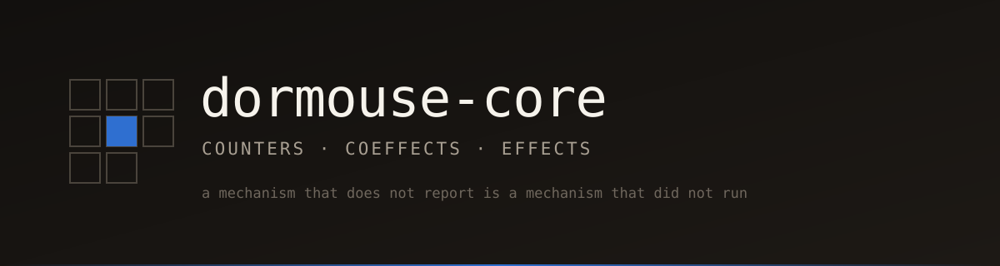

<p align="center">
  
</p>

<p align="center">
  <a href="https://github.com/dormouse-ai/dormouse-core/actions/workflows/ci.yml"></a>
  <a href="https://pypi.org/project/dormouse-core/"></a>
  <a href="LICENSE"></a>
  
</p>

**The discipline layer.** No dependencies beyond the standard library.

A mechanism that does not report is a mechanism that did not run; an incompatible
component is refused before it allocates; removing a component restores the context
bit for bit; every error names the way out.

[Русский](#русский) · [Why](#why-this-package-exists) · [Guarantees](#guarantees) · [Install](#install)

---

## Why this package exists

Nine times in this project a mechanism was switched on, the run trained, and the
mechanism never executed:

| what was enabled | what actually happened |
|---|---|
| a KDA attention arm | 3 126 forward passes, **zero** backward passes |
| `use_kda=false` | meant *no attention at all*, not "attention without KDA" |
| mHC residual mixing | initialised at the opposite corner of the simplex |
| a SIGReg regulariser | 67 % of the term was a constant that could not be optimised |
| an export to ternary | shipped bf16 bytes labelled `ternary` |
| an eval metric | reported `0.000` because the loss path never filled it |

None of it was visible in a log, and none was caught by the ~3 000 tests we had —
because those tests compared the code to itself. A test that pins our own output
proves only that the code has not changed, not that it is right.

This package makes that class of failure impossible by construction, in four
small mechanisms.

## Guarantees

| guarantee | mechanism | how it fails |
|---|---|---|
| an enabled mechanism must prove it ran | `Counters.enable(name, counter=...)` then `check()` | `MissingReport` naming every silent mechanism |
| an incompatible component cannot half-start | `Coeffects.requires` / `.provides` | refusal **before** `activate()` runs, with the gap quoted |
| removing a component restores the context exactly | `Effect` carries its inverse; `Slot.deactivate` reverts in reverse order | property test over arbitrary key sets |
| a config cannot lie | `Config.from_mapping` | unknown key = error, wrong type = refused (not coerced), `bool` is not an `int` |
| a run is an artifact | `Journal` | append-only JSONL; a swap is an event with its step number |
| a long run is not a surprise | `Plan.require_approval` | refuses a plan over budget unless approved |

## Use

```python
from dormouse_core import Coeffects, Counters, Effect, Slot

counters = Counters()
counters.enable("kda", counter="kda_bwd", why="chunked delta rule")
counters.count("kda_fwd")
counters.check()          # raises MissingReport: kda never reported a backward pass
```

```python
class Rope:
    name, slot = "rope", "pos"

    def coeffects(self) -> Coeffects:
        return Coeffects(provides={"pos": "rope"})     # it claims the position scheme

    def activate(self, ctx: dict[str, str]) -> list[Effect]:
        return [Effect.set(ctx, "pos", "rope")]        # the inverse is carried with it

    def deactivate(self) -> None:
        return None


slot = Slot()
slot.activate(Rope())
assert slot.ctx == {"pos": "rope"}
slot.deactivate("pos")
assert slot.ctx == {}                                  # exactly what it was
```

## Install

```bash
python -m venv .venv && .venv/bin/pip install -e '.[dev]'
.venv/bin/python -m pytest
.venv/bin/ruff check . && .venv/bin/mypy src
```

CI runs the same commands on Python 3.12, 3.13 and 3.14, checks that the public
API has not changed without a version bump (`api.txt`), builds a wheel, and audits
it for known vulnerabilities.

## Design rules

1. **One concept per module.** Enforced by a test: at most one public class unless
   the module declares its concepts in `__concepts__`.
2. **A budget, not a wish.** The package may not exceed 900 source lines. When the
   ceiling is reached the answer is to delete or move code, not to raise it.
3. **No golden hashes from our own runs.** A test that pins our output is a lint
   error; numeric mechanisms are checked against a reference computed outside this
   repository.
4. **Errors carry an escape.** `LoudError(what, escape)` renders as
   `what. Escape: how to fix it`.

## License

MIT.

---

# Русский

**Слой дисциплины.** Никаких зависимостей кроме стандартной библиотеки.

Механизм, который не доложил, что работал, — не работал. Несовместимый компонент
получает отказ **до** выделения памяти. Удаление компонента возвращает контекст
бит-в-бит. Любая ошибка называет выход.

## Зачем этот пакет существует

Девять раз в этом проекте механизм включали, прогон обучался, а механизм **не
выполнялся**:

| что включили | что произошло на самом деле |
|---|---|
| плечо KDA-внимания | 3 126 прямых проходов, **ноль** обратных |
| `use_kda=false` | означало «внимания нет вообще», а не «внимание без KDA» |
| mHC-смешивание остатков | инициализация в противоположном углу симплекса |
| регуляризатор SIGReg | 67 % терма — константа, которую нельзя оптимизировать |
| экспорт в тернар | уехали байты bf16 с меткой `ternary` |
| метрика eval | показывала `0.000`, потому что путь лосса её не заполнял |

Ничего из этого не было видно в логах, и ничего не поймали ~3000 тестов — потому
что тесты сверяли код **сам с собой**. Тест, который пинует наш собственный вывод,
доказывает только то, что код не менялся, а не то, что он верен.

## Что гарантируется

| гарантия | механизм | как падает |
|---|---|---|
| включённый механизм обязан доложить | `Counters.enable(...)`, затем `check()` | `MissingReport` со списком всех молчащих |
| несовместимый компонент не начнёт работу наполовину | `Coeffects` | отказ **до** `activate()`, с названной причиной |
| удаление возвращает контекст точно | `Effect` несёт обратную операцию | property-тест на произвольных наборах ключей |
| конфиг не может соврать | `Config.from_mapping` | неизвестный ключ = ошибка; `bool` не проходит как `int` |
| прогон — это артефакт | `Journal` | append-only JSONL; замена компонента = событие с номером шага |
| долгий прогон — не сюрприз | `Plan.require_approval` | отказ, если план дороже бюджета |

## Установка

```bash
python -m venv .venv && .venv/bin/pip install -e '.[dev]'
.venv/bin/python -m pytest
```

## Лицензия

MIT.
